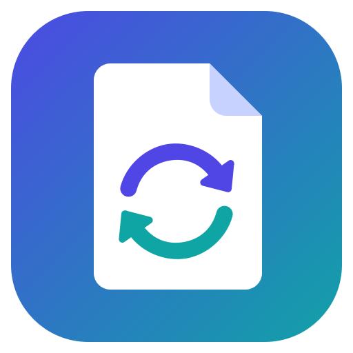
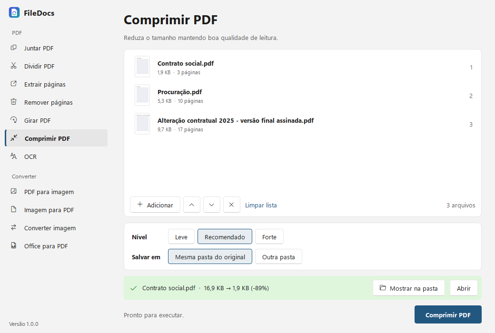
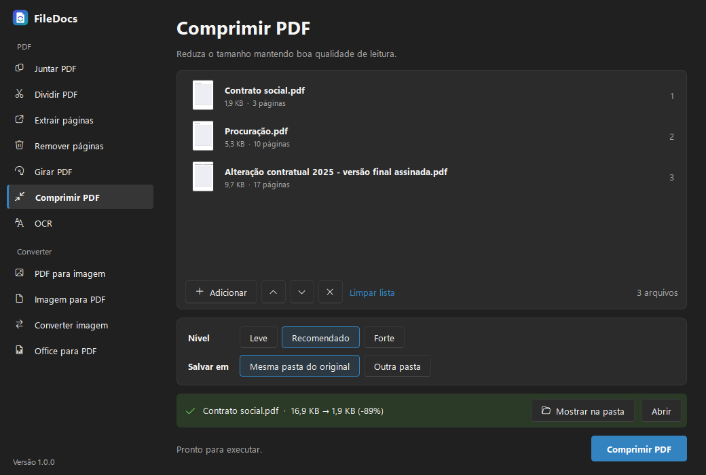
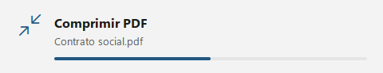
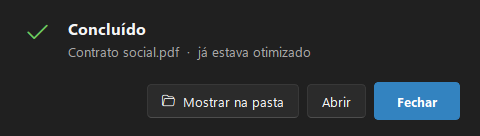

<p align="center">
  
</p>

<h1 align="center">FileDocs</h1>

<p align="center">
  <b>Junte, divida, comprima e faça OCR nos seus PDFs sem enviar nada para a internet.</b><br>
  Um iLovePDF que roda no seu Windows, direto do clique direito.
</p>

<p align="center">
  <a href="https://github.com/levi-mota/FileDocs/releases/latest"></a>
  
  
</p>

<p align="center">
  
  
</p>

---

## Por que usar

- **Seus documentos não saem do computador.** Contratos, procurações e documentos pessoais não passam por nenhum site.
- **Direto do Explorer.** Clique direito no arquivo → *FileDocs* → *Comprimir*. Em poucos segundos o resultado está na mesma pasta.
- **OCR em português.** Transforma digitalizações em PDFs pesquisáveis, que permitem buscar e copiar o texto.
- **Instala e pronto.** Não exige administrador nem a instalação de Python, Tesseract ou outros programas.
- **Combina com o Windows.** Segue o tema claro/escuro e a cor de destaque do sistema.

## O que ele faz

| | Ferramenta | Para quê |
|---|---|---|
| 📑 | **Juntar PDF** | Vários PDFs e imagens em um arquivo, na ordem que você quiser |
| ✂️ | **Dividir PDF** | Uma página por arquivo |
| 📄 | **Extrair páginas** | Novo PDF só com as páginas escolhidas (`1-3, 5, 8-`) |
| 🗑️ | **Remover páginas** | Tira páginas do documento |
| 🔄 | **Girar PDF** | 90°, 180° ou 270° |
| 🗜️ | **Comprimir PDF** | Leve, recomendado ou forte, mostrando quanto o arquivo diminuiu |
| 🔍 | **OCR** | Reconhece o texto de PDFs e imagens escaneados |
| 🖼️ | **PDF para imagem** | Cada página vira PNG ou JPG |
| 📷 | **Imagem para PDF** | Fotos e digitalizações num PDF |
| 🎨 | **Converter imagem** | JPG, PNG, WEBP, HEIC (iPhone), BMP, TIFF, ICO |
| 📝 | **Office para PDF** | Word, Excel e PowerPoint* |

<sub>* Requer o <a href="https://www.libreoffice.org/">LibreOffice</a> instalado: <code>winget install TheDocumentFoundation.LibreOffice</code></sub>

## Clique direito

Selecione um ou vários arquivos no Explorer → **Mostrar mais opções** → **FileDocs**.

<p align="center">
  
  
</p>

Com vários arquivos selecionados, todos são processados juntos numa única janela.

## Instalação

1. Baixe o **`FileDocs-Setup-x.y.z.exe`** em [**Releases**](https://github.com/levi-mota/FileDocs/releases/latest).
2. Execute e avance. Pronto.

> Na primeira execução, o Windows pode mostrar "O Windows protegeu o computador", porque o instalador não tem assinatura digital.
> Clique em **Mais informações → Executar assim mesmo**.

Para desinstalar: *Configurações → Aplicativos → FileDocs → Desinstalar*. O menu de contexto sai junto.

📖 [Guia de uso completo](docs/USO.md)

## Para desenvolvedores

```powershell
py -3.12 -m venv .venv
.venv\Scripts\pip install -r requirements.txt
.venv\Scripts\python src\main.py                                   # abre a interface
powershell -ExecutionPolicy Bypass -File installer\build.ps1       # gera o instalador
```

```
src/filedocs/   ops.py (operações) · gui.py (interface) · shell.py (menu de contexto)
assets/         logo
vendor/         idiomas do OCR
installer/      PyInstaller + Inno Setup
tests/          teste das operações
```

Nova ferramenta = uma função em `ops.py` + uma linha em `OPS`. A interface monta o resto.
Detalhes em [docs/DESENVOLVIMENTO.md](docs/DESENVOLVIMENTO.md).

## Feito com

[PyMuPDF](https://pymupdf.readthedocs.io/) · [OCRmyPDF](https://ocrmypdf.readthedocs.io/) · [Tesseract](https://github.com/tesseract-ocr/tesseract) · [Qt / PySide6](https://doc.qt.io/qtforpython-6/) · [Pillow](https://python-pillow.org/) · [Inno Setup](https://jrsoftware.org/isinfo.php)

<p align="center"><sub>FileDocs · <a href="https://github.com/levi-mota">Levi Mota</a></sub></p>
